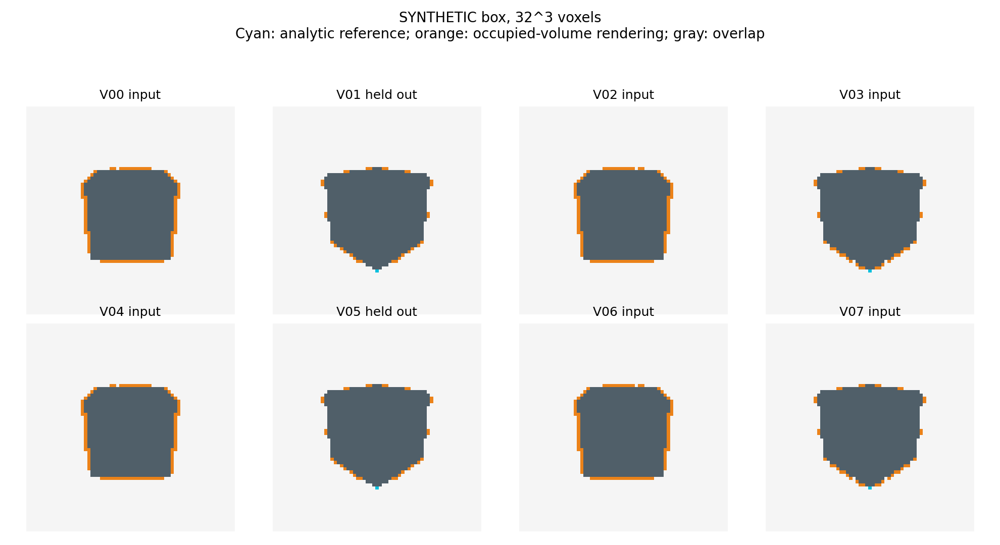
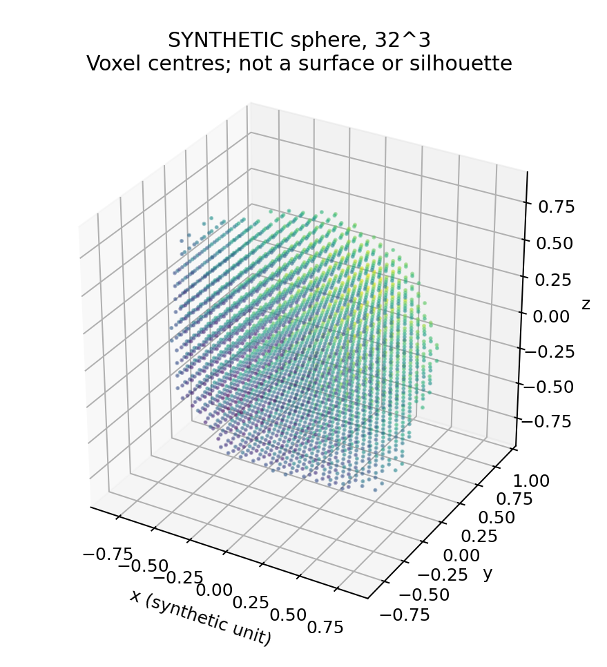

# Reconstruction preparation and readiness

Implementation and synthetic validation only, 5 November 2026. **Real-object
reconstruction remains blocked.** The current command generates analytic
primitives; it has no real-image/mask input or learned-model execution mode.
No new GPU job, 3D model checkpoint or model environment was added for this phase.
SAM 3 jobs `270796` and `271689` retain their separately staged source and outputs.

All **48 reconstruction CPU tests passed**. The combined repository suite
collected **214 tests: 212 passed, two OpenCV-dependent tests skipped locally**.
The [validation record](cpu_validation.json) captures the interpreter and test
count. Earlier pilot OpenCV checks passed on the cluster; the queued inference
job reruns the complete pilot suite in that environment.

## Implemented and validated

- Explicit calibrated cameras with original image dimensions, named distortion,
  world-to-camera transforms, frame/unit metadata and checked inverse projection.
- Configurable camera subsets, bounds and voxel resolution; missing-view and
  invalid-calibration failures; silhouette-based carving and PLY/occupancy export.
- Solid occupied-voxel ray rendering, independent of projected-point scatter.
- Per-camera IoU, Dice and boundary F1, fixed input/held-out partitions, explicit
  missing views, construction/alignment leakage checks and reference provenance.
- Positive-scale landmark alignment, temporal geometry-change diagnostics,
  resource/failure records and figure/table functions.
- Metadata-only adapters for SAM 3D Objects, Hunyuan3D-2, SF3D and InstantMesh.
  They prepare auditable recipes and validate artifact identifiers; they do not
  execute preprocessing or model inference. The common camera bridge preserves
  intrinsics, extrinsics, distortion and declared units across these interfaces.

Read [visual-hull implementation](VISUAL_HULL_IMPLEMENTATION.md),
[evaluation contract](RECONSTRUCTION_EVALUATION.md),
[model plan](3D_MODEL_COMPARISON_PLAN.md) and
[measured synthetic validation](SYNTHETIC_RESULTS.md).

## Synthetic results and limits

Eight virtual cameras observe an analytic box or sphere. Six input cameras are
fixed in the configuration; V01 and V05 are held out before carving. Masks come
from direct ray/primitive intersections, not from the reconstructed occupancy.
The same predetermined partition is used at 16 and 32 voxels per axis.

| Known primitive | Resolution | Input mean IoU, 6 views | Held-out mean IoU, 2 views |
|---|---:|---:|---:|
| Box | 16 cubed | 0.8299 | 0.8468 |
| Box | 32 cubed | 0.9125 | 0.9607 |
| Sphere | 16 cubed | 0.8515 | 0.7569 |
| Sphere | 32 cubed | 0.8807 | 0.8174 |

These are **synthetic correctness/resolution checks**, not Assembly101 results
or comparisons with learned models. Finite-view visual hulls can overfill
unobserved regions; centre-based carving and solid-box rendering also have
different discretization effects. Higher resolution does not by itself recover
concavities or prove metric accuracy. The driver records all per-view scores,
volumes, source/config hashes and measured CPU resource fields in
[synthetic_validation.json](synthetic_validation.json). Runtime/memory here
describe local CPU implementation validation, not cluster GPU throughput.





## Mandatory real-data release gates

The [readiness manifest](real_data_readiness.json) retains all three diagnostic
objects as pending. [The evidence auditor](../../reconstruction/readiness.py)
requires scoped, hash-verified review records for:

1. Native mask/physical-instance approval, including partial visibility and tools.
2. Camera accuracy supported by independent geometric evidence; valid JSON and
   rotation matrices alone cannot pass.
3. Measured synchronized correspondence, or a separately verified static state
   explicitly restricted to a static comparison.
4. Verified coordinate conventions and scale evidence, or an explicit nonmetric
   shape-only restriction. Unknown units never become metric by labeling them.
5. Frozen image/mask/calibration/source provenance for the proposed run.

A review must identify the exact object, recording and ordered camera inventory,
name its reviewer/approval reference, and preserve limitations. Diagnostic SAM
outputs cannot serve as approval evidence. Hash validation checks records, not
physical truth; the reviewer must inspect the actual evidence. Even a complete
test attestation bundle cannot enable a real run in this implementation phase.
The synthetic CLI rejects real or diagnostic data kinds. Low-level geometry
functions are mathematical utilities, not scientific approval.

Current blockers: no independently accepted real mask review, inconclusive
camera-accuracy evidence, no raw-video clock mapping or complete static-state
approval, and unverified physical scale. The user also lacks access to the
separate official synchronized/rectified release. Source-frame hashes are
available, but a real reconstruction input/holdout bundle has not been frozen.

## Reproduction

Use an existing CPU environment with NumPy/Pillow; plotting also needs
Matplotlib. The measured plotting environment is recorded in
[CPU requirements](../../reproducibility/environments/reconstruction-cpu-requirements.txt).
No environment installation or model package is necessary to run geometry tests.

```bash
python -m unittest discover -s tests -p 'test_reconstruction_*.py' -v
python -m reconstruction.synthetic_validation \
  --config configs/reconstruction_synthetic.json \
  --output experiments/reconstruction_benchmark/NEW_SYNTHETIC_RUN \
  --figures research_artifacts/reconstruction_benchmark/figures
```

Choose a new output directory; prior PLY and occupancy files are not overwritten.
Full synthetic solids/PLY are ignored under `experiments/reconstruction_benchmark/`;
only lightweight figures/reports are versioned. The figures directory may be
regenerated deliberately from the same frozen configuration. There is no real
reconstruction submission script in this phase. Full-resolution native RGB and
SAM masks remain in the dedicated cluster segmentation directory.

## Deferred work

Mesh extraction and a production mesh/splat renderer are deferred; the common
evaluation hook requires a real documented surface renderer, not points.
Independent 3D reference geometry and real scale/alignment measurements remain
unavailable. No mask-fitting alignment optimizer or hyperparameter search is
implemented. Future model wrappers must execute and capture their internal
crop/padding/recentering transforms, isolate dependencies and measure actual
resources only after dataset release and a storage plan. SAM 3D requires
separate checkpoint approval and SF3D separate terms; neither is needed now.
