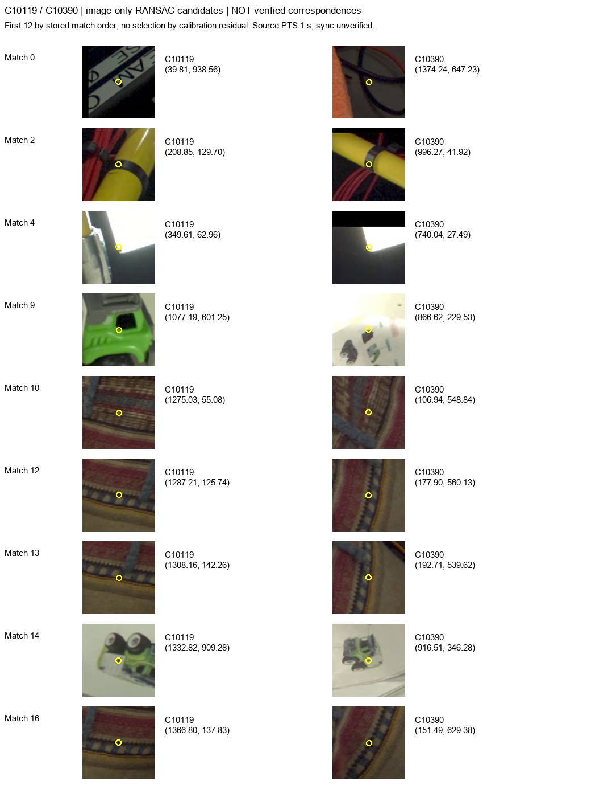
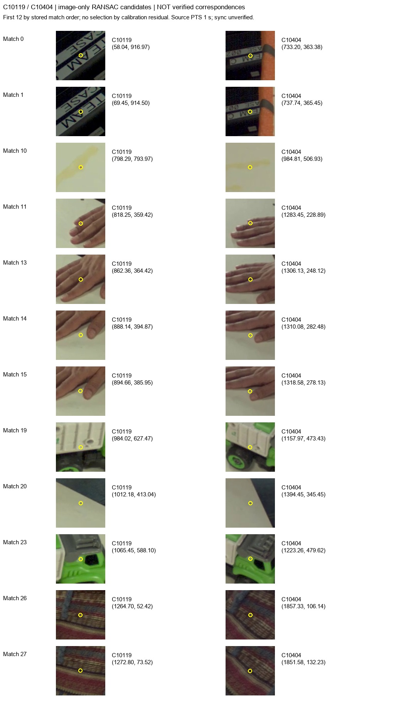

# Calibration and correspondence validation

Evidence reviewed: 5 November 2026 (Asia/Singapore). **Accepted reconstruction benchmark pilots: 0.** Three recordings are diagnostic candidates. Native 2D mask review is useful, but it does not make the multiview dataset ready. No reconstruction was performed.

## Evidence and scope

| Evidence | Slurm job | Measured coverage |
|---|---:|---|
| Bounded original-video survey | 268336 | 3 recordings x 8 cameras; 180 decoded frames per view over local elapsed 0 to 2.983333 s; 72 saved native PNG samples |
| Two-image epipolar diagnostics | 268824 | C10119 paired with the other 7 cameras at each source stream's local elapsed 1.0 s; 21 pairs |
| Manual-landmark local stability | 270038 | green01 only; 6 manually identified object landmarks in each of 6 views; 180 frames per view |

Source reports remain immutable. Local review copies are under `data/segmentation_source_review/`; complete cluster outputs are under `/projects/_ssd/jointposeaction/experiments/segmentation_pilot/`:

- `survey-268336/survey.json`
- `geometry-268824.json`
- `stability-270038/stability.json` (the local copy is `stability-270038.json`).

Diagnostic-only SAM3 job **270796** does not change any calibration, synchronization or benchmark-readiness gate. Its masks must be presented with their diagnostic scope.

| Candidate | Exact recording ID | Calibration JSON SHA-256 |
|---|---|---|
| green01 | `nusar-2021_action_both_9012-c07c_9012_user_id_2021-02-01_164345` | `5adef00cf6030247f76ab89f00e52c27ee6a0eea0fe03f7532c0bd3263c9e18f` |
| crane02 | `nusar-2021_action_both_9015-b05b_9015_user_id_2021-02-02_161800` | `b7a9aba37397861c1cb57bc93b9ef2d7cd7478c4de9359f8f8c1c6658305ce34` |
| green03 | `nusar-2021_action_both_9034-c08b_9034_user_id_2021-02-04_161726` | `92777143be4150018768f5fb4d1cc110cf2ae73a53dca35926eb572848f5353a` |

All three source recordings belong to the existing recognition **training** split. This is not an independently sampled segmentation benchmark, and action labels are not used to disambiguate instances during mask evaluation.

## Verified calibration representation

Dataset revision: `bfc15ea5e3f0bc8f8c232af6c1b45aa137a9d967`. Official AssemblyHands toolkit revision: `8d4b7f1bce3f99874514199aae7504f78ebf3517`.

The recording-specific [official Nimble JSON files](https://github.com/facebookresearch/assemblyhands-toolkit/tree/8d4b7f1bce3f99874514199aae7504f78ebf3517/calib/nimble_json_calib) were matched by exact recording filename. Each selected file contains all eight expected fixed-camera serials:

`C10095_rgb`, `C10115_rgb`, `C10118_rgb`, `C10119_rgb`, `C10379_rgb`, `C10390_rgb`, `C10395_rgb`, `C10404_rgb`.

Each camera entry uses `Camera.SerialNo`, `DistortionModel=OpenCV`, `ImageSizeX=1920`, `ImageSizeY=1080`, scalar `fx/fy/cx/cy`, a 4 x 4 `ModelViewMatrix`, and named radial/tangential distortion coefficients. The wrappers identify the fixed cameras as exocentric OptiTrack color cameras. Decoded native frames match the 1920 x 1080 calibration dimensions in all 24 surveyed views. File SHA-256 values match the survey manifest.

The [official camera implementation](https://github.com/facebookresearch/assemblyhands-toolkit/blob/8d4b7f1bce3f99874514199aae7504f78ebf3517/calib/camera.py) establishes OpenCV right/down/forward camera coordinates and pixel-center image coordinates. Stored `ModelViewMatrix` maps world to camera: `X_camera = R X_world + t`. The toolkit internally stores its inverse, then reverses that transform when projecting. Our loader explicitly uses the stored world-to-camera matrix; positive depth alone is not treated as accuracy evidence.

The [official distortion implementation](https://github.com/facebookresearch/assemblyhands-toolkit/blob/8d4b7f1bce3f99874514199aae7504f78ebf3517/calib/camera_distortion.py) lists its tuple as `(k1,k2,k3,p1,p2)`. OpenCV receives the named conversion `(k1,k2,p1,p2,k3)`; coefficient vectors are not copied positionally. Native images remain distorted originals. Rectified-video calibration is not substituted.

Checks pass for finite intrinsics/distortion/transforms, positive focal lengths, principal points within the image, homogeneous last rows, unique serials, proper rotations and decoded resolution. Across all 24 cameras, rotation determinants lie within `[0.9999999999999998, 1.000000000000001]`; the largest elementwise `|R.T @ R - I|` is `1.1102230246251565e-15`.

**What this verifies:** vendor provenance, exact file/serial association, documented projection convention, representation integrity and image-resolution compatibility. **What it does not verify:** physical camera-pose accuracy, complete scene applicability, physical translation units, absolute capture timing or cross-view synchronization. Translation units remain unverified; no millimetre, metre or metric hand/object fusion claim is made.

## Two-image geometric diagnostics

SIFT descriptors are matched using a 0.75 ratio test and mutual matching. Candidate points are undistorted into each original intrinsic matrix. An image-only fundamental matrix is fitted by RANSAC (1 native-pixel threshold, confidence 0.999, at most 10,000 iterations, seed 20261104). **The supplied calibration matrix is never used to select RANSAC inliers.** The diagnostic then evaluates the known-calibration fundamental matrix on those image-selected candidates.

For world-to-camera transforms, the relative transform is `T2 @ inverse(T1)` and `F = inverse(K2).T @ skew(t) @ R @ inverse(K1)`. Reported residuals are the arithmetic mean of both point-to-epipolar-line distances in undistorted native pixels. These are **2D-to-2D epipolar residuals**, not 3D reprojection errors, silhouette IoU or reconstruction results. Point undistortion still uses vendor intrinsics/distortion, so the procedure does not independently certify those parameters.

All pairs below use **C10119 paired with the listed camera**, each at its own source-local 1.0 s. Numbers are rounded to six decimals; full precision and candidate coordinates remain in `geometry-268824.json`. A dash means no supported residual summary, not zero error.

| Candidate | Other camera | Mutual candidates | Image-RANSAC inliers | Calibration median px | Calibration p95 px | Status |
|---|---|---:|---:|---:|---:|---|
| green01 | C10095 | 39 | 25 | 0.335845 | 8.093994 | descriptive correspondences available |
| green01 | C10115 | 34 | 21 | 1.571591 | 106.144314 | descriptive correspondences available |
| green01 | C10118 | 50 | 36 | 0.453493 | 2.851960 | descriptive correspondences available |
| green01 | C10379 | 7 | - | - | - | insufficient candidate matches |
| green01 | C10390 | 19 | 9 | 96.806559 | 641.066025 | descriptive correspondences available |
| green01 | C10395 | 5 | - | - | - | insufficient candidate matches |
| green01 | C10404 | 58 | 35 | 2.150001 | 2.781209 | descriptive correspondences available |
| crane02 | C10095 | 23 | 11 | 0.754243 | 104.318332 | descriptive correspondences available |
| crane02 | C10115 | 44 | 33 | 0.542474 | 129.075257 | descriptive correspondences available; planar/repetition warning |
| crane02 | C10118 | 21 | 11 | 156.099627 | 525.756835 | descriptive correspondences available |
| crane02 | C10379 | 10 | - | - | - | insufficient candidate matches |
| crane02 | C10390 | 19 | 8 | 570.741494 | 1072.725619 | descriptive correspondences available |
| crane02 | C10395 | 15 | 10 | 265.085494 | 571.956380 | descriptive correspondences available |
| crane02 | C10404 | 56 | 41 | 1.177386 | 2.285614 | descriptive correspondences available |
| green03 | C10095 | 26 | 10 | 18.213554 | 697.564271 | descriptive correspondences available |
| green03 | C10115 | 16 | 8 | 267.996832 | 896.447020 | descriptive correspondences available |
| green03 | C10118 | 18 | 9 | 1.317916 | 797.806963 | descriptive correspondences available |
| green03 | C10379 | 13 | 7 | - | - | insufficient image ransac inliers |
| green03 | C10390 | 12 | 7 | - | - | insufficient image ransac inliers |
| green03 | C10395 | 11 | - | - | - | insufficient candidate matches |
| green03 | C10404 | 37 | 17 | 0.881379 | 2.457615 | descriptive correspondences available |

Some pairs show small median residuals, but large tails, insufficient matches and extreme residuals prevent blanket geometric validation. In green01, C10390 has median **96.806559 px** from only 9 image-selected inliers; C10115 has p95 **106.144314 px**. Repeated objects printed on instruction paper, low overlap, mismatches, planar structure, motion and/or incorrect calibration applicability can contribute. These possibilities have not been adjudicated by independent manual correspondences. The diagnostic therefore neither certifies calibration accuracy nor proves that every large residual is a camera error. A small fitted-F residual on its own selected inliers is not accuracy ground truth.

### RGB patch review

The first 12 image-RANSAC inliers by stored correspondence order were rendered
for one high-residual and one low-residual pair. Selection uses no known-camera
residual; the original reports are unchanged. All 9 C10390 inliers are shown.
Agent visual inspection found that **match 9 pairs the physical cab window in
C10119 with a toy illustration on paper in C10390**. Match 0 pairs a printed
equipment label with a cable region. Several sweater-texture matches remain
ambiguous. These are concrete correspondence failures, so the high residual
cannot be attributed solely to bad calibration. No new calibration acceptance
or independently verified reference set is inferred from this inspection.

The C10404 sheet includes plausible toy-part correspondences, but also hands
and repeated clothing. It still requires independent review and sufficient
camera coverage; a few plausible points do not certify the eight-camera rig.

Each patch is 96 x 96 native pixels enlarged to 128 x 128 for inspection, with
its location marked in yellow. Coordinate values and exact image hashes are
recorded in [source_figure_manifest.json](figures/source_figure_manifest.json).

## Local object-landmark stability

green01 was visually identified as one green-and-white assembled garbage truck with gray cab roof and black wheels; the screwdriver is a separate excluded instance. Six named points per assessed camera were selected from native initial RGB frames without using action labels. Manual identity/configuration inspection is recorded evidence, not independent ground truth or global rigidity certification.

The criteria were fixed before evaluating the tracks: maximum native-image displacement **2.0 px**, maximum forward/backward LK error **0.75 px**, minimum valid tracking fraction **0.95**, at least **4** named object landmarks spanning at least **20%** of the ROI in both image axes. Tracks use forward/backward pyramidal Lucas-Kanade, preserve failures and do not reacquire lost points from background. The decoded initial image must exactly match the annotated survey PNG hash, PTS and RGB pixels.

Acceptance was declared only for local elapsed **0 to 1.0 s**, comprising 61 decoded frames. The full **0 to 2.983333 s**, 180-frame trace is also retained. The table gives the maximum over the six landmarks and minimum per-landmark valid fraction; the complete per-point results and trace hashes remain in the source report.

| Camera | First 1 s max drift px | First 1 s max FB px | First 1 s min valid | First 1 s | Full window max drift px | Full window max FB px | Full window min valid | Full window |
|---|---:|---:|---:|---|---:|---:|---:|---|
| C10095 | 0.207709 | 0.006044 | 1.000000 | PASS | 1.299922 | 0.741662 | 1.000000 | PASS |
| C10115 | 0.230364 | 0.026986 | 1.000000 | PASS | 0.427430 | 0.026986 | 1.000000 | PASS |
| C10118 | 6.697340 | 1.721988 | 0.852459 | FAIL | 10.442024 | 1.721988 | 0.288889 | FAIL |
| C10119 | 0.186384 | 0.002695 | 1.000000 | PASS | 0.311416 | 0.004067 | 1.000000 | PASS |
| C10390 | 0.248089 | 0.013352 | 1.000000 | PASS | 0.277041 | 0.018690 | 1.000000 | PASS |
| C10395 | 0.196323 | 0.009541 | 1.000000 | PASS | 0.258157 | 0.010577 | 1.000000 | PASS |

**C10118 fails and is not overridden.** The failing landmarks are `tailgate_upper_left` and `cab_roof_corner`; the first-second minimum valid fraction is 52/61 = 0.852459, and full-window minimum is 52/180 = 0.288889. Optical-flow drift/loss can reflect motion, occlusion, texture ambiguity or tracking failure; the measurements do not establish which cause applies.

C10379 and C10404 were not assessed by this manual-landmark run. C10379 is substantially obscured by instruction paper in the visual survey; absence of a stability measurement is not a pass. crane02 and green03 have no corresponding local object-landmark acceptance result.

The five green01 views passing these local criteria are **C10095, C10115, C10119, C10390 and C10395**. Their selected landmarks remain locally stable; that does not establish stability of every object part, agreement between unknown absolute capture times, cross-view physical configuration identity or geometric calibration accuracy. **There is no global static-pilot approval.**

## Temporal correspondence remains unresolved

The [official toolkit documentation](https://github.com/facebookresearch/assemblyhands-toolkit#visualizing-exocentric-videos) distinguishes its synchronized, rectified exocentric release from the original Assembly101 videos, whose views need not be synchronized. Equal frame numbers, 60 fps declarations and equal MP4 start PTS are not evidence of physical simultaneity. Survey samples are explicitly labeled RAW PTS / synchronization unverified.

No independent shared-event fit/held-out temporal mapping has been established for these three recordings. No measured cross-camera clock offset, drift bound or physical timestamp is therefore reported. Local object stability is not substituted for such a mapping. Static corresponding views could eventually support a limited static-state benchmark without simultaneous exposure, but only after separate configuration/identity and camera-geometry evidence is accepted; they would still not support dynamic hand/object alignment.

The official [rectified exocentric release folder](https://drive.google.com/drive/folders/1e_TIb2et_bBoa15DoBFjDT3pV-Ivqqzl?usp=sharing) and [release README](https://drive.google.com/file/d/1ssakEvQPAfNLG1RNLsLRuZsU70gI31tL/view?usp=drive_link) redirected to Google sign-in or were inaccessible to the unauthenticated research tools. The user subsequently confirmed that their account also lacks access. SAM 3 approval does not grant access to this separate release. Archive sizes and selective-acquisition granularity were not verified. The official visualizer expects recording-local `calib.txt`, synchronized rectified 30 fps video and 60 fps annotation indices; its calibration and timing contract must not be mixed with the original raw 60 fps streams.

## Minimal evidence needed to accept or reject a pilot

1. Manually verify a small set of identifiable physical image correspondences across a connected graph of overlapping camera pairs, away from repeated instruction-paper pictures. Preserve the annotation provenance and location uncertainty. Report known-calibration epipolar residuals on those references without using that calibration to choose or filter matches. Reprojection errors require genuinely independent 2D/3D references; none are currently available.
2. Inspect the object configuration and visible movable components across proposed frames, separately from landmark stability. Exclude failed/occluded views and document them. Do not promote untracked parts or unassessed candidates to stable status.
3. For synchronized/dynamic use, measure shared visible events on fit and held-out samples across cameras, preserve original PTS, and report offset/residual bounds over the observed interval. Alternatively obtain the official synchronized release plus its corresponding per-recording calibration and documented index mapping after checking access, sizes and dedicated-storage capacity.
4. If calibration applicability or object/temporal correspondence is unsuitable, reject the candidate and survey another calibrated recording. Do not relax thresholds after seeing failures. If only the limited static-state interpretation is supported, name that scope explicitly and retain `temporal_sync_verified=false`.
5. Keep all three candidates diagnostic and benchmark count at **0** until the material evidence is resolved and the mask review is accepted. Resolve physical units before metric hand/object or scale-sensitive claims. No reconstruction follows automatically from a successful 2D mask.

## Reproduction and immutable evidence

Implementation: [`calibration.py`](../../segmentation_pilot/calibration.py), [`epipolar.py`](../../segmentation_pilot/epipolar.py), [`stability.py`](../../segmentation_pilot/stability.py). Full source image hashes, native PTS/timebases, calibration hashes, script hashes and trace paths are captured in the machine-readable reports.

| Reviewed local report | SHA-256 |
|---|---|
| `survey.json` | `2bcabab3599347decf28e2515d647491d43e9745407cd2361c87aa56ac56696d` |
| `geometry-268824.json` | `459a1499cf3eae39857891a5c6add33719a4402fc8a992448501af610fe0c8d8` |
| `stability-270038.json` | `2e8e1278c4a02d0934abdfa0edbf740b8ea0cf6d3acf4560137c570a92f48bb4` |

Survey video payload transferred: **214,958,080 bytes**; native-frame/contact-sheet outputs before the survey manifest: **148,952,896 bytes**. Stability re-read payload: **55,574,528 bytes**; trace outputs before its manifest: **2,831,398 bytes**. No full video file or RGB archive was downloaded by these bounded jobs.
