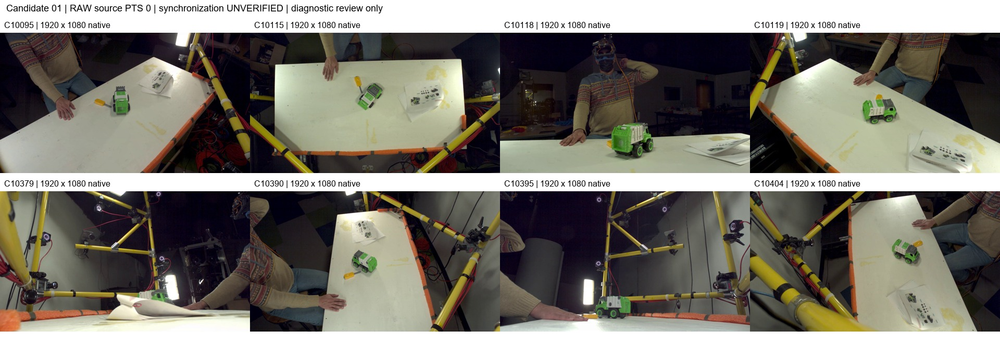
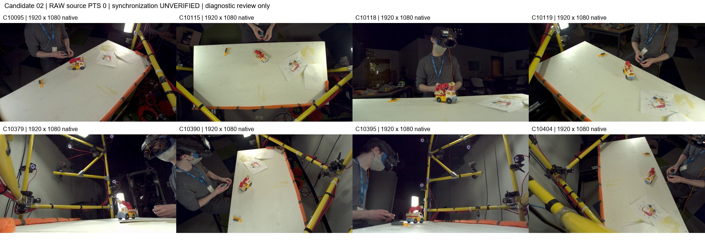
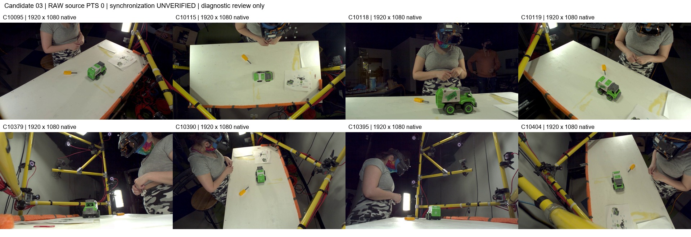

# Candidate selection and acquisition

Reviewed 5 November 2026, Asia/Singapore. These are **three diagnostic
candidates, zero accepted reconstruction benchmark pilots**. Calibration
accuracy and temporal correspondence remain unresolved. No real reconstruction
has been run.

SAM 3 and CPU review jobs have since completed. See the
[completed inspection and mask comparison sheets](INSPECTION_270796.md).

| ID | Recording | RGB target and assessment |
|---|---|---|
| green01 | `nusar-2021_action_both_9012-c07c_9012_user_id_2021-02-01_164345` | Green/white garbage truck with gray cab roof; visible in several views, substantially hidden by instruction paper in C10379. Five of six assessed views pass local landmark stability; C10118 fails. |
| crane02 | `nusar-2021_action_both_9015-b05b_9015_user_id_2021-02-02_161800` | Yellow/white crane truck with red folded boom and hook. Mostly visible; articulation/configuration needs further checking. |
| green03 | `nusar-2021_action_both_9034-c08b_9034_user_id_2021-02-04_161726` | Second green/white garbage-truck geometry with side label. Good initial visibility; full static-state verification is pending. |

All three recordings belong to the frozen recognition **training** split and
have exact recording-specific original camera files. Target descriptions come
from visual inspection of RGB, without using action labels for instance choice.
The toys provide two vehicle families and two truck geometries; they do **not**
constitute three independent object categories or a diverse final benchmark.
Separate screwdrivers, printed toy illustrations, people and background are
excluded from the declared physical targets. Occluded parts are not invented.

All eight fixed RGB cameras were surveyed:
`C10095`, `C10115`, `C10118`, `C10119`, `C10379`, `C10390`, `C10395`, `C10404`.
No moving HMC camera is part of this pilot.

## Source frames and time scope

The original 1920 x 1080, 60 FPS streams were decoded for local elapsed
0 to 2.983333 seconds: 180 frames per camera. Native samples at local
0.0, 1.0 and 2.5 seconds were saved, totaling 72 PNGs. Source PTS has
time base 1/15360. Initial segmentation inputs use each stream's PTS 0.
**Matching PTS or frame indices do not establish simultaneous capture.**

The figures retain all views, including occlusions. They are downsampled native
frames with external labels; they are neither rectified nor synchronized.
See [calibration validation](CALIBRATION_VALIDATION.md) for measured diagnostics.

## Bounded acquisition and storage

Dataset revision:
`bfc15ea5e3f0bc8f8c232af6c1b45aa137a9d967`.
The three complete eight-view recordings would total **25,205,511,657 bytes**;
they were not downloaded. Byte-range video access consumed **214,958,080 bytes**
for the survey and **55,574,528 bytes** for landmark tracking. The saved survey
files total **150,335,042 bytes**, including its manifest. Twenty public original
calibration JSONs totaled **190,595 bytes**; only the three matching recordings
are candidates. Source range budgets reject full-file responses and retain
source revision, remote ETag/size, PNG hashes, PTS and decoder provenance.

The isolated SAM 3 environment adds **427,558,864 bytes**, plus **6,961,455 bytes**
of pinned upstream source. It shares the unchanged recognition Torch base.
One official checkpoint adds **3,450,062,241 bytes**, verified by SHA-256.
Quota measured before tracking was **39,710,994,507 / 50,000,000,000 bytes**.
The inference job reserves at most 3 GiB of output plus 2 GB remaining headroom;
the packed mask worst case is 2,488,320,000 bytes. Full probability tensors are
disabled. No additional allocation, RGB archive or reconstruction checkpoint
was acquired.

## Files and current workflow

Complete cluster directory:
`/projects/jointposeaction/experiments/segmentation_pilot/`.

- `discovery-267862/`: recording inventory and official calibration sources.
- `survey-268336/`: immutable survey manifest and full-resolution native frames.
- `geometry-268824.json`: all automatic correspondences and residuals.
- `stability-270038/`: local landmark measurements and complete point tracks.
- `environment-269431/`, `checkpoint-269584/`: successful setup provenance.
- `inputs-270796/`: exact 24-image manifest and calibration assessment.
- `sam3-270796/`: completed native text-only/refined predictions.
- `review-271689/`: completed CPU-generated visual package.

[Prompt boxes](../../configs/segmentation_diagnostic_boxes.json) were drawn by
agent visual inspection before inference, then checked as RGB crop montages.
They identify instances, not ground-truth segmentation boundaries. Source
hashes and figure transformations are in
[source_figure_manifest.json](figures/source_figure_manifest.json).

The original proposal, Phase 0 audit and historical segmentation/reconstruction
utilities were reviewed. Old magenta-threshold masks lack native prediction
provenance and are excluded. Recognition datasets, checkpoints and results are
preserved. Once a candidate fails applicability or correspondence checks, it
must be rejected or narrowed explicitly and another candidate surveyed; mask
quality alone cannot approve it for reconstruction.
